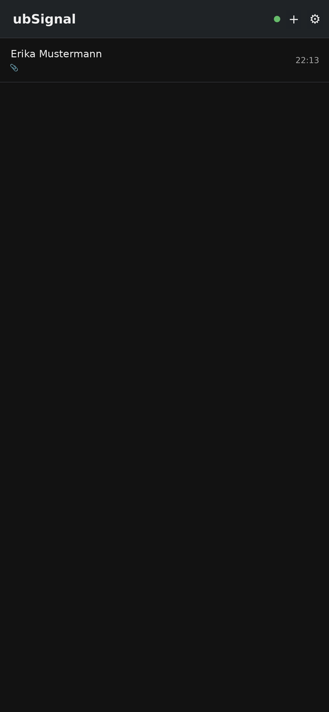
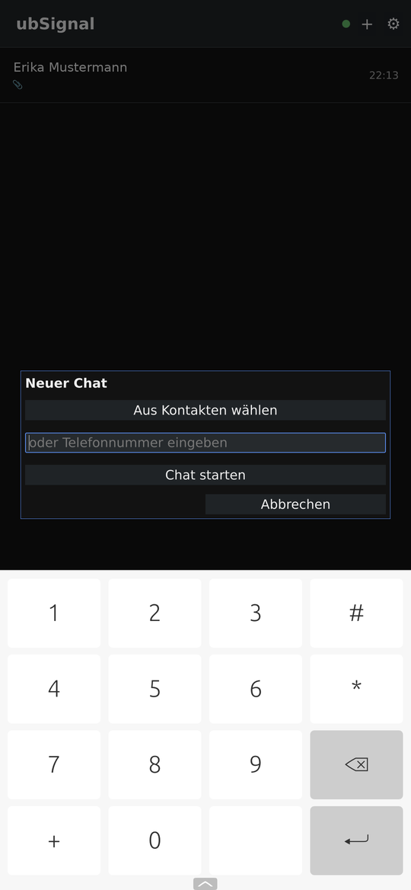
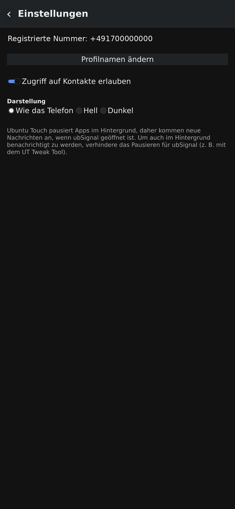
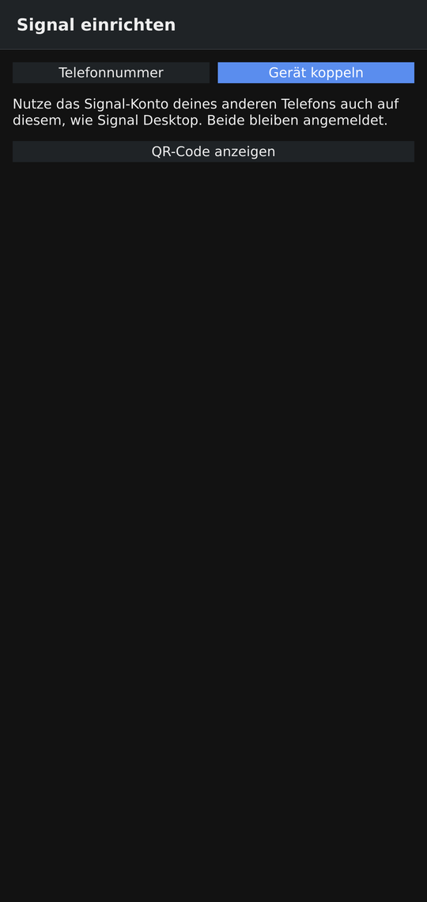
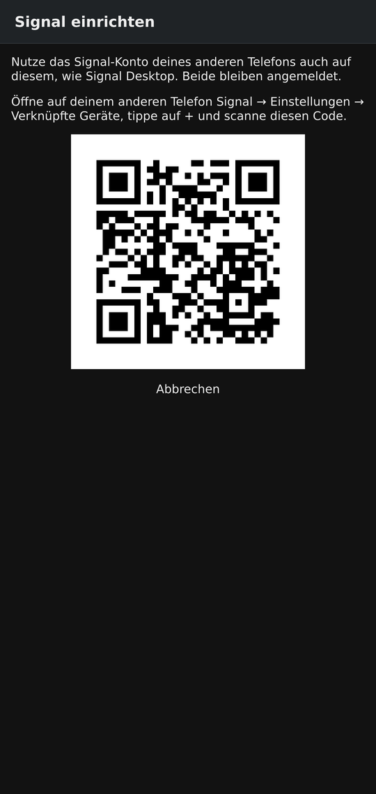

# UT Langis


A native Signal messenger for Ubuntu Touch. UT Langis can register the phone
as the **primary device** of your phone number, like the Signal apps for
Android and iOS do — no other phone and no pairing needed. Alternatively it
can be **linked** to the account of another phone by QR code, like Signal
Desktop.

The Signal protocol work is done by [presage](https://github.com/whisperfish/presage)
(Rust, on top of Signal's own `libsignal`). The user interface is Qt 5.12 /
QML, like the other ubTouch apps.

| Chats | New chat | Settings |
| :---: | :---: | :---: |
|  |  |  |

Names and numbers in the screenshots are placeholders.

## Features

- Set-up either way: registration as primary device with captcha and SMS or
  voice-call code, or linking as an additional device of an existing account
  by scanning a QR code with the Signal app on another phone
- Profile name
- One-to-one and group chats: receive, send text and photos
- Images open full screen with a tap; pinch or double-tap to zoom
- Emoji panel in the chat (😊), with recently used emoji
- Voice messages: record (🎤) and play, AAC like Signal's own apps
- Delivery state of own messages: ✓ sent, ✓✓ delivered, green ✓✓ read;
  UT Langis confirms delivery and (optionally, Settings) reading in return
- Rename a one-to-one chat (✎), e.g. for someone not in the address book;
  address book names and own names are kept over Signal profile names
- Reactions (press and hold): 👍 👎 ❤️ 😂 😮 😢, shown under the message,
  also those from others; tap your reaction again to take it back
- Reply to a message (press and hold → Reply): the reply carries a quote
  of it, as in Signal's own apps
- Delete messages (press and hold): for this phone, or for everyone within
  24 hours of sending; deletions by others are applied too
- New chats by phone number or picked from the address book (after asking
  for permission once; Signal contact discovery is only asked about the
  chosen number)
- Conversation list with unread counts, notifications while the app runs:
  sound selectable (phone default, silent, any of the phone's notification
  sounds), off for all chats or muted per chat (🔔/🔕 in the chat)
- Light/dark appearance
- English, German, French, Spanish and Italian; follows the phone's language
  or a language chosen in the settings

Not (yet) included: calls, stories, registration lock PIN, linking further
devices (Signal Desktop) to UT Langis when it is the primary device.

## Important before registering

- **Your number moves to this phone.** Registering signs Signal out on any
  other phone that uses the same number. Your old chat history is not
  transferred.
- **Registration lock:** if your Signal account has a PIN with registration
  lock, turn the lock off in the old app first (Settings → Account →
  Registration lock). UT Langis cannot answer the PIN challenge.
- Signal tolerates third-party clients but does not support them; server
  changes can break UT Langis until presage is updated.

## Linking instead

| Choose "Link device" | Scan with the other phone |
| :---: | :---: |
|  |  |

The QR code in the screenshot is a placeholder (it points to this project).

Choose *Link device* on the set-up page and tap *Show QR code*. On the
other phone open Signal → Settings → Linked devices → + and scan the code.
The other phone stays the primary device; UT Langis receives contacts and new
messages (not the old history) and manages no profile of its own.

## Registering

1. Enter your number in international format (`+49…`) and tap *Continue*.
2. Solve the captcha. When it is solved, the page tries to open a
   `signalcaptcha://` link, which UT Langis catches. If the captcha does not
   work in the app, solve it in a browser at
   <https://signalcaptchas.org/registration/generate.html>, copy the
   *Open Signal* link and paste it into the field below the captcha.
3. Enter the 6-digit code from the SMS or call.
4. Set the name people see.

## Coming from ubSignal

UT Langis was called ubSignal before (package `ubsignal`); the name changed
because Signal's trademark policy does not allow "Signal" in the names of
third-party apps. Ubuntu Touch sees the renamed package as a new app, so the
account and chats have to move once. With the phone connected over USB:

```bash
clickable build
sh tools/migrate-from-ubsignal.sh
```

It installs UT Langis, copies the data over and removes the old app (or says
how to remove it). The old folders stay as a backup until deleted.

## Building

Requirements: [Clickable](https://clickable-ut.dev) 8.7 or later and Docker.

```bash
clickable build      # build the click package (arm64)
clickable install    # install it on the phone over adb
clickable logs       # follow the app's log
```

The first build takes a while: clickable adds a Rust toolchain, CMake 3.31
and a current `protoc` to its container image (see `clickable.yaml`), and
cargo then compiles libsignal and BoringSSL for arm64. Later builds only
recompile what changed. Cargo's downloads and output live in `build/`.

`core/` can also be built on the development machine for a quick check:

```bash
cd core && cargo build
```

## Releases

`.github/workflows/build.yml` builds the arm64 click package on GitHub Actions
and attaches it, with a `SHA256SUMS` file, to a GitHub release:

1. Raise `version` in `manifest.json` and commit.
2. Tag that commit with the same version and push the tag:

   ```bash
   git tag v0.1.4
   git push origin main v0.1.4
   ```

The workflow refuses a tag that does not match `manifest.json`. Without a tag,
*Actions → Build click → Run workflow* builds the package as a downloadable
workflow artifact; ticking *Publish the result as a GitHub release* turns it
into a pre-release named `build-<date>`.

The first run takes long (libsignal and BoringSSL are compiled for arm64).
Cargo's downloads and compiled dependencies are cached between runs, keyed on
`core/Cargo.lock`, so later runs only rebuild what changed.

## Layout

```
core/                 Rust backend (static library with a C interface)
  include/utlangis_core.h   the C interface the app links against
  src/lib.rs          C functions, command and event format
  src/worker.rs       backend thread, registration, receive loop start
  src/receiver.rs     receive loop and incoming messages
  src/commands.rs     send, history, contact lookup, profile
  src/convert.rs      Signal contents -> message rows
  src/threads.rs      conversation list (threads.json)
  src/titles.rs       contact and group names
  src/files.rs        attachments on the phone
src/                  C++: SignalClient (bridge), list models, notifications,
                      LanguageManager, VoiceNotes (GStreamer recording/playback)
qml/                  pages and components
i18n/                 translations
```

## Data on the phone

Everything lives in `~/.local/share/utlangis/`: `signal.db3` (keys, sessions,
messages; SQLite), `threads.json` (conversation list) and `attachments/`.
The app's AppArmor confinement keeps other apps out of it. Deleting the
folder (or uninstalling) removes the account from this phone; the number then
has to be registered again.

## Translations

All user-visible texts are marked with `qsTr()` (QML) or `tr()` (C++).
After changing texts, refresh the `.ts` file with `lupdate` from the
Clickable container and fill in the translations:

```bash
docker run --rm -u $(id -u):$(id -g) -v "$PWD":/p -w /p \
  clickable/amd64-20.04-arm64:latest /usr/lib/qt5/bin/lupdate -no-obsolete \
  -locations relative src/*.cpp qml/*.qml \
  -ts i18n/utlangis_de.ts i18n/utlangis_fr.ts i18n/utlangis_es.ts i18n/utlangis_it.ts
python3 i18n/translate.py   # fills all languages; lists any text still missing
```

## Platform constraints

- **Build against Qt 5.12** (`ubuntu-sdk-20.04`): `import QtQuick 2.12` at
  most, `Connections { onSignal: … }`.
- **Lomiri suspends background apps.** The message connection dies while the
  app is suspended; UT Langis reopens it when it comes back to the foreground
  and then receives everything that arrived meanwhile. Notifications in the
  background only work if suspension is turned off for UT Langis (e.g. with
  UT Tweak Tool). Signal has no push service for Ubuntu Touch.
- **Permissions** (`utlangis.apparmor`): `networking` for Signal's servers,
  `webview` for the captcha page, `content_exchange` to pick photos from
  other apps, `push-notification-client` for notifications, `contacts` for
  the contact picker, `audio` and `microphone` for voice messages (Ubuntu
  Touch asks once before the microphone is used). The app reads the address
  book only after the user allowed it in its own dialog (or in Settings).
  `contacts` is a reserved policy group: sideloading works, the OpenStore
  would review it manually.
- **`QT_QUICK_CONTROLS_STYLE=Default` is set in `main.cpp`**, and pages use
  `AppLabel` / `AppField` so both light and dark theme stay readable.

## License

AGPL-3.0, as presage and libsignal, see `LICENSE`.
